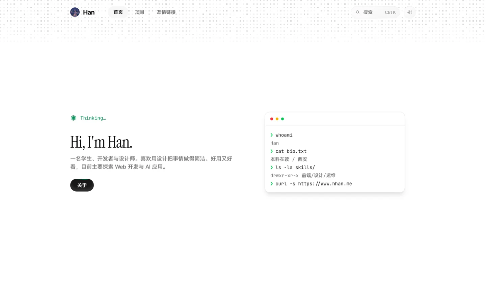

<div align="center">

# Han · 个人主页

**学生 · 开发者 · 设计师**

把想法变成看得见的作品。

[](https://nextjs.org)
[](https://react.dev)
[](https://www.typescriptlang.org)
[](https://tailwindcss.com)
[](https://ui.shadcn.com)
[](LICENSE)

[在线预览](https://www.hhan.me) · [项目](https://www.hhan.me/projects) · [友情链接](https://www.hhan.me/friends)

<picture>
  <source media="(prefers-color-scheme: dark)" srcset="docs/preview-dark.webp">
  
</picture>

</div>

## 简介

这是一个个人主页兼作品集，用 Next.js App Router 写成：首页一屏交代「我是谁、在做什么」，两个内容页分别放项目与友链。界面偏克制——排版靠字体与留白，动效只在进入时出现一次，深浅色与中英文各有一套完整文案。

站点默认中文、跟随系统主题；语言与主题选择都会记在 `localStorage`，下次访问保持原样。

> 博客已恢复运行：`/blog` 与 `/feed.xml` 正常输出，文章结构与维护方式见[下文](#博客)。

## 功能特性

**首页**（`/`）

- **Hero**：标题逐字浮现，右侧终端卡片逐行「输入」`whoami` / `cat bio.txt` 等命令
- **关于**：一段自我介绍 + 坐标 / 年龄 / 人格 / 年级四格、技能与开发工具徽章
- **专注领域**：开发运维、创意设计、影像创作三块；设计作品可点开大图并左右翻页
- **贡献**：GitHub 近一年热力图（按容器宽度裁到整数周），滚动进入视口才加载，旁边是两枚数据卡
- **联系**：社交卡片（GitHub / X / 邮箱 / QQ / Bilibili / 爱发电等），微信公众号二维码在弹窗里

**内容页**

- `/projects`：精选项目、用户评价、分类筛选，截图可放大浏览
- `/friends`：友链卡片，末尾一条是邮件申请入口（名单见 `src/lib/friends.ts`）

**全局**

- **命令面板**：`Ctrl K` / `⌘ K` 唤起，可跳转区块与页面、切主题、切语言
- **主题与语言**：next-themes 的 `class` 策略 + 自建字典 i18n，无需刷新切换
- **阅读辅助**：顶部滚动进度条、回到顶部按钮、光标聚光、区块滚动显现
- **SEO 与可访问性**：Open Graph / Twitter 元数据、`/sitemap.xml`、`/robots.txt`；语义标签、`aria-label`、可见键盘焦点，并尊重系统的 `prefers-reduced-motion`

## 技术栈

| 领域 | 选型 |
| ---- | ---- |
| 框架 | Next.js 16（App Router）· React 19 |
| 语言 | TypeScript 5 |
| 样式 | Tailwind CSS 4 · shadcn/ui（`radix-nova` 风格）· Radix UI |
| 动效 | Motion · tw-animate-css · CSS 合成器动画 |
| 组件 | cmdk（命令面板）· useanimations（图标）· simple-icons（品牌图标）· react-github-calendar |
| 博客 | @fancyapps/ui（看图）· qrcode（分享海报） |
| 字体 | MiSans（CDN）· 标题宋体子集（本地 `public/fonts`）· JetBrains Mono（next/font） |
| 工具链 | pnpm 11 · ESLint 9（`eslint-config-next`） |

## 快速开始

需要 **Node.js ≥ 20.9.0**（Next.js 16 的要求）与 **pnpm**（仓库锁定 `pnpm@11.22.0`）。

```bash
pnpm install
pnpm dev        # 开发模式，http://localhost:3000
```

生产构建与本地预览：

```bash
pnpm build
pnpm start
```

代码检查：

```bash
pnpm lint
```

## 环境变量

写在项目根目录的 `.env.local`（已被 `.gitignore` 忽略）。全部可选，不配置也能跑起来。

| 变量 | 用途 |
| ---- | ---- |
| `NEXT_PUBLIC_SITE_URL` | 站点绝对地址，用于 Open Graph、RSS 与 sitemap。缺省回落到 `https://www.hhan.me`（见 `src/lib/site.ts`） |
| `TURSO_DATABASE_URL` | Turso 数据库地址，**仅恢复博客后需要**，用于存文章「有用」计数 |
| `TURSO_AUTH_TOKEN` | 对应的 Turso 访问令牌 |

## 目录结构

```
homepage/
├── src/
│   ├── app/                     # App Router 路由与元数据
│   │   ├── page.tsx             # 首页：Hero → About → Focus → Contributions → Contact
│   │   ├── layout.tsx           # 根布局：字体、主题、语言、导航、命令面板
│   │   ├── globals.css          # Tailwind 4 入口、字体与设计令牌
│   │   ├── projects/            # 项目页
│   │   ├── friends/             # 友链页
│   │   ├── blog/                # 博客路由
│   │   ├── feed.xml/            # RSS 订阅源
│   │   ├── sitemap.ts           # /sitemap.xml，revalidate 3600s
│   │   └── robots.ts            # /robots.txt
│   ├── components/              # 页面区块与通用组件
│   │   ├── ui/                  # shadcn/ui 基础组件
│   │   └── blog/                # 博客视图组件
│   ├── lib/                     # 数据与工具
│   │   ├── i18n.ts              # 中英文案字典（唯一文案来源）
│   │   ├── projects.ts          # 项目与专注领域数据
│   │   ├── socials.ts           # 联系方式
│   │   ├── friends.ts           # 友链名单
│   │   ├── site.ts              # 站点地址
│   │   └── blog*.ts             # 文章读取、渲染与元信息
│   └── registry/magicui/        # 内置的 magicui 组件（终端、文字动画等）
├── blog/                        # 文章内容：<slug>/index.md + 同目录图片
├── public/                      # 图标、字体、作品截图
├── scripts/setup-blog-db.mjs    # 初始化博客数据表
└── docs/                        # README 预览图
```

## 内容维护

改内容基本只需要动下面这几个文件，不用碰组件：

| 想改什么 | 改哪里 |
| -------- | ------ |
| 首屏文案、关于、各区块标题与说明 | `src/lib/i18n.ts`（`zh` / `en` 两套，结构一致） |
| 社交链接、邮箱、公众号入口 | `src/lib/socials.ts` |
| 友链名单 | `src/lib/friends.ts` |
| 项目、截图、专注领域作品 | `src/lib/projects.ts` |
| 站点域名 | `NEXT_PUBLIC_SITE_URL` 或 `src/lib/site.ts` |
| 头像与站点图标 | `public/icon.png`、`src/app/icon.svg` |
| 作品图与封面 | `public/*.webp` |

两套语言共用同一份结构，只加中文不补英文会导致英文站点出现空字段，记得成对修改。

## 博客

`/blog`、`/blog/<slug>`、`/blog/<slug>/<文件名>`、`/feed.xml` 均已启用：文章随仓库存储、运行时读取，导航、命令面板与 sitemap 均已收录入口。文章「有用」计数依赖 Turso 数据库，属可选项，不配置不影响博客浏览。

**文章结构**——一个目录即一篇文章，目录名就是 slug：

```
blog/
└── nextstep2026/
    ├── index.md          # frontmatter + Markdown 正文
    ├── DSC00369.webp     # 图片与正文同目录，正文里用相对路径引用
    └── ...
```

`index.md` 头部是 `---` 包裹的 frontmatter：

```markdown
---
title: 文章标题
description: 列表页与 RSS 显示的摘要。
category: 随笔
tags: [标签一, 标签二]
date: 2026-07-06
---

正文段落……


```

**启用「有用」计数（可选）**：

1. 安装数据库依赖 `pnpm add -D @libsql/client`（脚本用的，目前不在依赖里）；
2. 配置 `TURSO_DATABASE_URL` / `TURSO_AUTH_TOKEN` 后执行 `node scripts/setup-blog-db.mjs` 建表。

## 部署

- **Vercel**：导入仓库，在环境变量里设置 `NEXT_PUBLIC_SITE_URL`，其余用默认构建即可。
- **自托管 Node**：`pnpm build && pnpm start`（运行环境需 Node ≥ 20.9）。

若日后恢复博客，注意 `blog/` 是运行时读取的目录：用 standalone 输出部署时必须在 `next.config.ts` 里打开 `outputFileTracingIncludes`，否则线上读不到文章。

## 说明

- **字体**：正文 MiSans 由 CDN 提供，标题宋体是用到的那几个字形做了子集、放在 `public/fonts`，等宽字体走 `next/font` 自托管。
- **动效**：入场过渡以 CSS 合成器属性为主，Motion 只用于需要感知滚动或视口的地方；开启「减少动态效果」后基本动画都会关掉。
- **统计**：页面接入了 51.LA 的访问统计脚本，加载策略为 `afterInteractive`，不阻塞首屏。

## 许可证

代码使用 [MIT](LICENSE) 许可证；站内文章内容采用 [CC BY-NC-SA 4.0](https://creativecommons.org/licenses/by-nc-sa/4.0/deed.zh) 协议。
